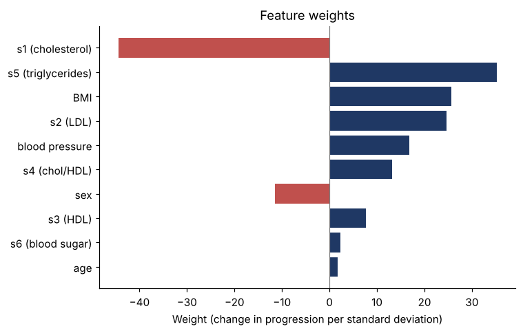
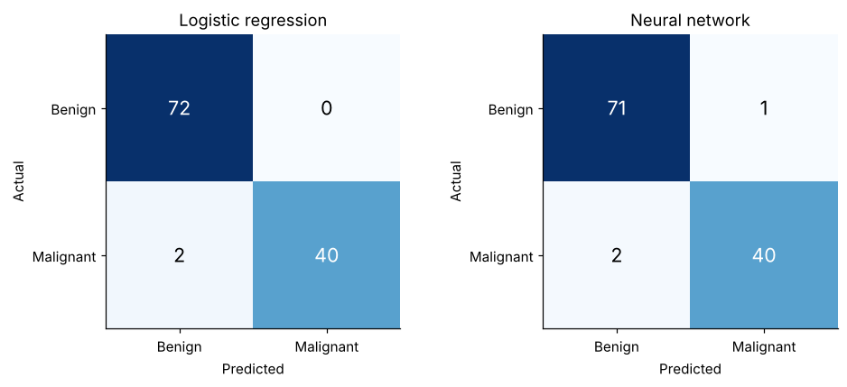

# Machine Learning from Scratch: Health Data

Linear regression, logistic regression and a neural network written from first principles in **NumPy**, then applied to two real clinical datasets. Each model is verified against an exact solution or scikit-learn, and the results are read the way a healthcare team would read them, not just by accuracy.

| Notebook | Question | Result |
|---|---|---|
| [01 Linear regression](notebooks/01_linear_regression_diabetes.ipynb) | Can 10 baseline measurements predict diabetes progression a year later? | Test R² **0.45**, identical to the closed-form solution and scikit-learn |
| [02 Classification](notebooks/02_classification_breast_cancer.ipynb) | Can cell nucleus measurements tell malignant from benign breast tumours? | **96.5 to 98.2%** test accuracy; 40 of 42 cancers caught |

## What's implemented

All in [`mlscratch/`](mlscratch), with no ML libraries:

- **Linear regression:** vectorised cost function, batch gradient descent, normal equation, feature scaling, R² and RMSE
- **Logistic regression:** sigmoid, cross-entropy loss, gradient descent with L2 regularisation
- **Neural network:** one tanh hidden layer, sigmoid output, backpropagation, Xavier initialisation
- **Evaluation:** confusion matrix, precision, recall and F1, written by hand

scikit-learn is used only to load the datasets, split them, and act as a reference to check the from-scratch results.

## Highlights



**Reading a model, not just running it.** The largest diabetes weight is on total cholesterol, and it's *negative*. That's not a medical finding: total cholesterol and LDL are 0.89 correlated, so the model offsets one against the other (multicollinearity). This same correlation is why gradient descent needed 5,000 iterations to converge. The condition number of XᵀX is 430, which makes the cost surface a long narrow valley.



**Accuracy isn't the whole story in diagnosis.** With malignant set as the positive class, *recall* is the share of cancers caught. Both models miss the same 2 of 42 cancers. Lowering the decision threshold all the way to 0.1 still misses them, which shows the model is confidently wrong on those cases. Those are cases to hand to a pathologist, not a threshold to tune away.

**A bug the tests caught.** The first version initialised network weights at 0.01, and the network sat on a saddle point and failed to learn XOR in 5,000 iterations. Switching to Xavier initialisation (scaling by 1/√fan-in) fixed it in under 2,000. The XOR test stays in the suite so the problem can't come back.

## Project structure

```
mlscratch/
  linear_regression.py   gradient descent, normal equation, scaler, metrics
  classifiers.py         logistic regression, neural network, classification report
notebooks/
  01_linear_regression_diabetes.ipynb
  02_classification_breast_cancer.ipynb
tests/
  test_models.py         9 unit tests: convergence, numerical stability, XOR, metrics
images/                  charts used in this README
```

## Run it

```bash
git clone https://github.com/Bahle05/ml-from-scratch.git
cd ml-from-scratch
pip install -r requirements.txt
pytest                      # 9 tests
jupyter notebook notebooks/
```

## Limitations and next steps

- Single train/test split on small datasets (114 test samples for cancer), so one misclassification moves accuracy by nearly a point. **k-fold cross-validation** would give steadier estimates.
- Add **ridge regression** to stabilise the correlated diabetes weights.
- Mini-batch gradient descent and the Adam optimiser for larger datasets.

## Data

- Diabetes: Efron, Hastie, Johnstone and Tibshirani (2004), *Least Angle Regression*, Annals of Statistics. Via scikit-learn.
- Breast cancer: Wolberg, Street and Mangasarian, Wisconsin Diagnostic Breast Cancer (UCI ML Repository). Via scikit-learn.

These are public research datasets. This project is for learning and is not a diagnostic tool.

## Author

**Bahle Ludidi**, BSc Computer Science (Information Systems), University of the Western Cape
[LinkedIn](https://www.linkedin.com/in/bahle-ludidi-727657352) · [GitHub](https://github.com/Bahle05)
